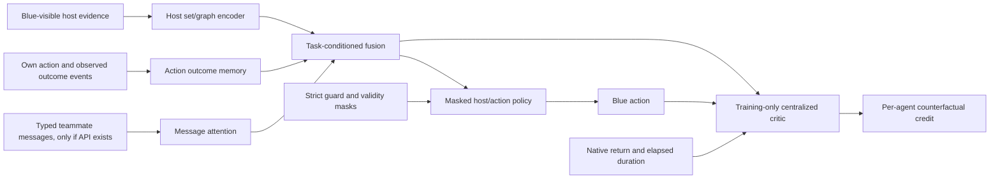

# Draft: task-modular Blue architecture comparison

**Status:** comparison implementation prepared; protocol is still not frozen.
Do not launch architecture training until the active Qwen event-time
credit-assignment comparison has finished on Kaggle and its result is recorded.
Branch: `blue/event-time-rl`.

## Question and hypothesis

Can Blue learn better if it has separate mechanisms for (1) interpreting the
current state of each host, (2) remembering what happened after its own actions,
(3) consuming reports from other Blue agents, and (4) estimating each agent's
contribution to shared team reward?

The hypothesis is that these are different information problems and should not
all be forced through one flat observation vector and one policy head. The
counter-hypothesis is that extra modules add parameters and optimization paths
without helping under sparse rewards. This is a hypothesis to test, not an
assumption that a larger architecture will win.

## What exists and what prior work says

- The current event-time actor is a per-host shared scorer with masked mean and
  max context pooling (`SetActor`). It learns to rank Analyse candidates inside
  the strict Lancer framework. The current main comparison keeps it fixed so
  Monte Carlo and GAE credit targets can be compared cleanly.
- Earlier Blue work found a factorized host-then-command actor improved
  behavior-cloning non-Sleep accuracy from 12.2% to 21.8%, but PPO fine-tuning
  later diverged. This supports the representation hypothesis, not a claim of
  RL success. The measurements are historical and use a different protocol.
- CAGE-4's published evaluation found its submitted MARL agents behind the
  heuristic agents overall; the best listed GNN MARL result was -193 versus
  heuristic results around -113 to -142 in that paper's 100 x 500-step
  evaluation. Those raw values are not comparable to our Qwen/400-tick runs.
- `EvidenceMemory` already retains selected positive telemetry changes until
  analysis, and the policy inputs include evidence age, belief, last action,
  and last success/failure. There is no explicit Blue-to-Blue message stream in
  the current event-time policy interface.

Primary references: [Deep Sets](https://papers.neurips.cc/paper_files/paper/2017/hash/f22e4747da1aa27e363d86d40ff442fe-Abstract.html),
[Graph Attention Networks](https://arxiv.org/abs/1710.10903),
[COMA](https://arxiv.org/abs/1705.08926),
[TarMAC](https://proceedings.mlr.press/v97/das19a.html), and the
[CAGE-4 evaluation](https://ojs.aaai.org/index.php/AAAI/article/download/35158/37313).

## Proposed hybrid, with boundaries between the jobs

### 1. Host-state and topology encoder

Represent each currently visible host as an entity token containing only
Blue-visible telemetry, its age/freshness and belief, its known role/zone, and
the validity/padding mask. Encode each token with a shared small MLP. Add one or
two layers of masked self-attention over hosts, or typed graph attention if the
wrapper exposes stable, Blue-known topology edges. This gives each host score
access to relevant peer/zone context while retaining a shared representation
for hosts and variable host counts.

Do not feed true Red sessions or hidden simulator state to this encoder. Do not
assume that a padded slot is a real host. Keep simulator-validity masks outside
the learned logits as they are today.

### 2. Own-action outcome memory

Maintain a small per-agent event state keyed by target host. Each event records
the requested action and target, dispatch time, pending/completed/failed status,
observed duration, and Blue-visible evidence change after completion. Update a
compact GRU or time-aware event encoder when the action status or observation
changes, including while the agent is locked out. A per-host query retrieves
the relevant action history for the next decision.

Add auxiliary prediction heads for observable outcomes only: action completion
status/duration and the next Blue-visible feature/evidence delta. Use the
prediction residual as an uncertainty/surprise feature, not as a claim that the
action caused every subsequent change. Keep native team return as the policy's
primary optimization target.

### 3. Teammate-message encoder (interface-gated)

Only enable this branch after a real, tested communication interface exists.
Represent each received message as a typed record: sender, target host or zone,
claim/event type, observation time, confidence/source, and age. Use receiver- or
host-query attention to select relevant messages. Preserve disagreement,
staleness, and source attribution; a report remains evidence, not verified
truth. Do not synthesize messages from centralized training state.

At present this encoder is a design slot only. The current policy has no
explicit teammate-message input, so a message-using comparison is not yet
implementable without a separately reviewed interface/data contract.

### 4. Task-conditioned decision head

Fuse host state, action-outcome memory, and (when available) message context.
Use small task queries/heads for host investigation, verification, and urgent
response. The strict policy continues to own action legality, pending-action
handling, coverage, and urgent recovery. Initially the learned head only ranks
valid free Analyse candidates, matching the active experiment's scope. A later
version can factor host selection from conditional command selection, with
global actions in a separate head.

### 5. Centralized training critic and contribution estimates

During training only, pool the five agents' Blue-visible encoded states,
pending-action events, and executed/requested action identities. Keep one
native-return value head and add an agent-conditioned counterfactual advantage:
estimate the return for the observed joint decision, then marginalize one
agent's decision while holding the other agents' decisions fixed. This follows
COMA's credit-assignment idea, adapted carefully to our asynchronous decisions
and durations. Use the actual duration between free decisions in the target.

If we want separate service, compromise, coverage, or intervention objectives,
give them separate diagnostic/value heads first. Do not silently combine them
as new reward shaping. Any constrained or weighted multi-objective policy needs
an explicit objective and frozen weights before training.

## First comparison to run after the active main experiment

Do not try to train all modules at once. The first comparison should test the
largest supported architectural question with available inputs:

| Arm | Encoder | Memory | Messages | Policy/guard |
|---|---|---|---|---|
| A: control | Current pooled `SetActor` | Current features and `EvidenceMemory` | None | Frozen strict Lancer framework |
| B: candidate | One masked candidate self-attention layer, using existing role/zone features | Identical to A | None | Identical to A |

The first code candidate is now available as
`blue.harness.attention_actor.CandidateAttentionActor`. It follows the existing
`forward(features, base, mask)` residual-scoring contract and is separate from
the frozen `SetActor` and event-time Qwen runner. It applies one multi-head
self-attention block over the current valid Analyse candidate set; the existing
feature rows already carry role/zone fields. Its 42-wide, 3-head configuration
has 19,027 parameters versus 19,009 for `SetActor(hidden=64)`, effectively size-matched
actor. Both initialize to zero residual, so the policy initially follows the
same heuristic distribution. Unit checks cover permutation equivariance,
masking, gradients, and empty candidate rejection. This is a first isolated
host-context test, not the full action-memory/message/critic hybrid above.

### Frozen-comparison proposal (to sign off before training)

| Item | Fixed protocol |
|---|---|
| Primary contrast | `SetActor(64)` vs `CandidateAttentionActor(42, heads=3)` |
| Policy boundary | Same strict Lancer guard, same candidate list, scorer, evidence memory, base logits, sampling/exploration, and residual scale |
| Learning | Same PPO update, elapsed-time credit chosen from the completed Qwen comparison, optimizer, rollout size, update count, and early-stop rule |
| Training regimes | Episode-level balanced mixture of scripted `discovery` and `finite`; no Red identity input to the actor and no switching Red within an episode |
| Evaluation | Separate discovery and finite reports, same paired seeds/episode horizon for both arms, plus strict Lancer and untrained-mixture controls |
| Pilot | 2 training seeds per arm, mechanics and gradient checks only; pilot cannot select a winner |
| Confirmation | At least 8 training seeds per arm, fresh audited train/dev/eval blocks; report paired native return, lower tail, coverage, compromise-time, and verified-remediation metrics |
| Selection | Attention advances only if the preregistered native-return gate beats the same strict guard without material harm in either Red regime; otherwise keep SetActor |

The source runner currently accepts only `llm` and `finite` for its event-time
training path. The architecture comparison needs a separate runner or a
reviewed episode-level Red factory supporting both `discovery` and `finite`;
do not quietly change the frozen Qwen runner to add this. Before training,
test that both arms produce identical requests when their residual heads are
zeroed, then freeze source hashes, seed lists, model sizes, and the credit
target in a new preregistration.

The user has now directed the architecture pilot to proceed while Qwen is
handled separately on Kaggle. This **pilot-only** protocol is therefore frozen
without claiming the Qwen credit result: lambda=1.0 Monte Carlo, the current
main MC arm's setting, is used identically for both actors. It cannot rank or
replace the Qwen credit comparison. Pilot train RNGs are 0 and 1 for each
architecture; paired episode seeds are 7616–7619; paired evaluation seeds are
7620 and 7621 under each Red regime. The 7600–7615 smoke/check seeds used
earlier are excluded. Each run uses 2 PPO iterations × 2 episodes/iteration ×
400 steps, with one Discovery and one Finite episode in every iteration. The
update settings match the frozen event-time run (gamma .99, lr .003, critic
lr .0003, bonus 1, temperature .5, exploration .5, 4 PPO/critic epochs,
minibatch 256, KL limit .02). Pilot evaluation has two seeds per regime and is
descriptive only; no success claim or confirmation block follows from these
sample sizes. The restartable runner is
`blue/training/architecture_pilot.sh`.

After that comparison, test explicit action-outcome memory as a separate
increment over the better supported encoder. Test teammate communication only
after an interface and message fixture are agreed. This order separates
architecture effects and avoids crediting a complex bundle for a gain that may
come from one component.

### Scripted Red regimes and controls

- Use both existing scripted regimes: `discovery` and `finite`. The former is
  the historical DiscoveryFSRed variant; the latter is FiniteStateRed.
- Before architecture training, pass the targeted scripted-Red regression
  tests. The initial run of `blue/tests_blue/test_red_variants.py` passed all
  three tests, covering construction/short stepping for both modes and the
  Sleep-Red sanity check. The longer upstream FiniteStateRed pytest could not
  collect in this venv because its test `conftest.py` imports optional `ray`,
  which is not installed; use the Blue wrapper test or a direct Blue-harness
  smoke rather than adding Ray just for collection.
- Train a single architecture arm on a frozen balanced episode mixture of
  discovery and finite, without giving the actor a Red identity label. Evaluate
  each regime separately. If mixed-regime episode training is not supported by
  the runner, first add/test episode-level Red selection; do not switch Red
  mid-episode.
- Compare both learned arms with the same strict Lancer control and the
  identically sampled untrained residual-mixture control. Use fresh,
  audited training/dev/evaluation seeds; never reuse the active Qwen seeds as
  final-evaluation evidence.
- Keep rewards, action space, observation/features, scorer, exploration,
  credit target, optimizer, rollout ticks, and checkpoint rule fixed. The
  active Qwen result should determine/freeze the credit target before this
  comparison starts.

### Gates and reporting

1. **Mechanics:** permutation of host rows permutes per-host scores the same
   way; padded/invalid hosts never receive probability; same-seed no-op actor
   exactly matches the strict guard; action/event records preserve requested,
   completed, failed, and duration separately; actor receives no privileged
   state.
2. **Pilot:** at least two independent training seeds per architecture on the
   balanced scripted pool. Require complete coverage, valid masked actions,
   finite nonzero gradients, and frozen KL limits. Pilot returns are
   descriptive, not an architecture-selection endpoint.
3. **Confirmation:** if pilot mechanics pass, run at least eight independent
   training seeds per architecture and report per-regime paired native return,
   coverage, compromised-host time, remediation verification, lower-tail
   outcomes, and episode-level uncertainty. Claim an RL improvement only if the
   attention actor beats the same-guard heuristic on the frozen primary metric
   and replicates across training seeds without material harm in either Red
   regime. Otherwise retain the simpler model.

## Current status / no-go conditions

- Main Qwen credit-assignment experiment remains locally paused at checkpoint
  7/12 of its first run. The user has assigned its continuation to Kaggle; no
  Kaggle job or artifact transfer was initiated from this worktree. Keep its
  actor architecture and checkpoint contract unchanged. Architecture training
  waits for the Kaggle run's final analysis so the credit target can be frozen.
- The scripted `discovery`/`finite` regression test above passed; the optional
  upstream long Finite test was blocked at collection by missing `ray`.
- This draft does not add messages, rewards, simulator hooks, or Red behavior.
  Any communication API or new training-only objective requires its own
  interface/reward review before implementation.
- Candidate actor implementation and its four unit checks are present, but no
  architecture training has been launched.
